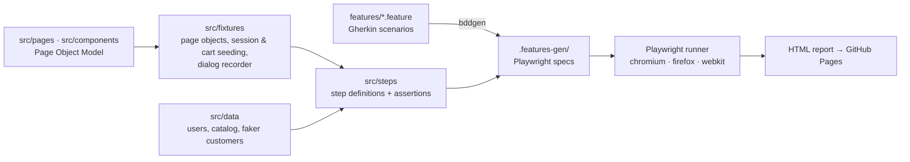

# playwright-pom-saucedemo

[](https://github.com/JulianBeta/playwright-pom-saucedemo/actions/workflows/playwright.yml)
[](https://julianbeta.github.io/playwright-pom-saucedemo/)

A **Playwright + TypeScript** test framework for [Swag Labs (saucedemo.com)](https://www.saucedemo.com),
built on the **Page Object Model** with **BDD (Gherkin)** scenarios. It covers functional,
security, visual, accessibility and timing checks across Chromium, Firefox and WebKit, and
documents 16 real defects with tests that track them.

**📊 Live report:** https://julianbeta.github.io/playwright-pom-saucedemo/ (published by CI on every run)

## Highlights

- **99 BDD scenarios** run on 3 browsers (281 tests), sharded across 6 CI jobs. Runs daily against the live site.
- **Page Object Model with components.** Page objects expose locators and actions; steps hold the assertions; every locator uses `data-test` attributes or ARIA roles.
- **Known bugs as expected failures.** Each defect is a scenario describing the _correct_ behavior, tagged `@known-bug @fail`. The suite stays green, and the day a bug is fixed Playwright reports _"expected to fail, but passed"_.
- **No fixed sleeps.** Uses auto-waiting locators, `expect.poll` for async lists, and **`page.clock`** to control the auto-rotating slider deterministically.
- **Fast, independent setup.** Fixtures start a session by setting the app's cookie and seed the cart through `localStorage`. Only the login tests use the login form.
- **Independent oracle for totals.** Tax and totals are checked against the product catalog, not against numbers read back from the page.
- **Visual regression** with `toHaveScreenshot()` (dynamic text masked), and **accessibility** scans with axe-core (WCAG 2.1 AA must pass; best-practice findings are attached to the report).

## Architecture



```
features/            Gherkin, grouped by area (auth, inventory, cart, checkout, navigation,
                     dynamic-catalog, known-bugs, quality)
src/pages/           BasePage + one page object per screen (incl. dynamic/ catalog pages)
src/components/      Header, SideMenu, Footer, ProductCard: shared UI parts
src/fixtures/        Playwright fixtures + createBdd() step factory
src/steps/           Step definitions by domain
src/data/            Demo users, product catalog (test oracle), random customers
src/utils/           Money math in cents, SPA-aware navigation
screenshots/         Approved visual baselines (per browser and OS)
docs/bugs/           One report per defect found
```

## Coverage

| Area                     | What is verified                                                                                                 | Scenarios |
| ------------------------ | ---------------------------------------------------------------------------------------------------------------- | --------: |
| Login & access control   | All users, 5 rejection messages, error dismissal, auth guard on 6 pages, logout, Back after logout               |        19 |
| Catalog, sorting, detail | Catalog data and images, 4 sort orders + default, all 6 detail pages, add from detail, unknown product id        |        15 |
| Cart                     | Add/remove from inventory and cart, badge, persistence across navigation and reload, continue shopping           |         7 |
| Checkout                 | Required fields, cancel at both steps, **item total / 8% tax / total for 1, 3 and 6 items**, end-to-end purchase |         9 |
| Navigation               | Menu (All Items, About, Reset App State, close), footer social links and copyright                               |         8 |
| Dynamic Catalog          | Spinner (async load), Lazy Load (infinite scroll, variant pricing), Slider (dots, auto-advance via `page.clock`) |        13 |
| Known bugs               | Expected failures for `problem_user`, `error_user`, `visual_user`, `performance_glitch_user` and shared defects  |        13 |
| Visual & accessibility   | 7 screens vs. visual baselines + `visual_user` vs. the standard baseline; axe-core WCAG 2.1 AA on 7 screens      |        15 |
| **Total**                | of which **16** are expected-failure (`@fail`) scenarios across the areas above                                  |    **99** |

Tags: `@smoke` `@auth` `@security` `@inventory` `@cart` `@checkout` `@e2e` `@navigation` `@dynamic-catalog` `@visual` `@a11y` `@performance` `@known-bug` `@BUG-0xx`

## Known bugs found

16 defects are documented in [docs/bugs](docs/bugs/README.md). Some highlights:

| ID                              | Defect                                                         | User         |
| ------------------------------- | -------------------------------------------------------------- | ------------ |
| [BUG-005](docs/bugs/BUG-005.md) | Last Name field does not accept typing, so checkout is blocked | problem_user |
| [BUG-008](docs/bugs/BUG-008.md) | Finish never completes the order                               | error_user   |
| [BUG-011](docs/bugs/BUG-011.md) | Checkout proceeds with an empty cart ($0.00)                   | all users    |
| [BUG-014](docs/bugs/BUG-014.md) | Lazy Load lists a variant twice per catalog cycle              | all users    |
| [BUG-015](docs/bugs/BUG-015.md) | Slider auto-rotation can't be paused (WCAG 2.2.2)              | all users    |
| [BUG-016](docs/bugs/BUG-016.md) | Every deep link answers HTTP 404 before a script redirects     | all users    |

## Run it

Requires Node.js 20+.

```bash
npm install
npx playwright install          # browsers

npm test                        # everything, all browsers
npm run test:smoke              # @smoke only
npm run test:regression         # everything except @known-bug
npm run test:known-bugs         # only the expected-failure defect tests
npm run test:visual             # visual regression (Chromium)
npm run test:a11y               # accessibility
npm run test:headed             # watch it run in Chromium
npm run test:ui                 # Playwright UI mode
npm run report                  # open the last HTML report
```

Visual baselines are stored per OS (`-darwin`, `-linux`). After an intended UI change, run
`npm run test:visual:update` locally, and trigger the **Playwright Tests** workflow with
_update_snapshots_ to refresh the Linux baselines used in CI.

## Quality gates

- **Pre-commit (Husky + lint-staged):** ESLint (`typescript-eslint` + `eslint-plugin-playwright`) and Prettier on staged files.
- **CI:** format check, lint and type check run first; then 3 browsers × 2 shards; reports are merged into one HTML report and published to GitHub Pages. Traces, videos and screenshots are kept for failures.

---

Built by **Julian Betancourt Cuervo**, Lead QA Automation Engineer · [julianbeta.github.io](https://julianbeta.github.io) · [LinkedIn](https://www.linkedin.com/in/julian-betancourt-cuervo-a05820ab/)
