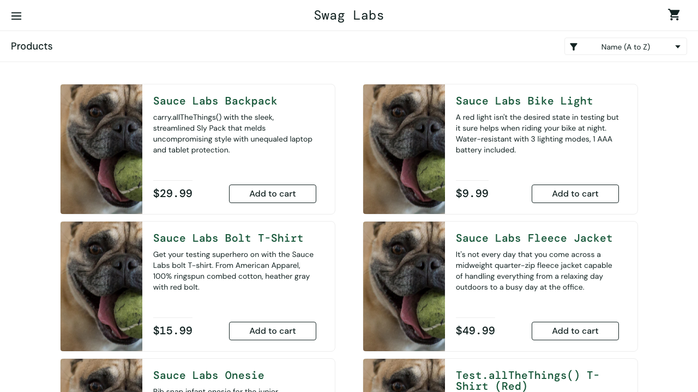

# BUG-001: Product images are replaced by a broken placeholder

|                    |                                                                          |
| ------------------ | ------------------------------------------------------------------------ |
| **Severity**       | High                                                                     |
| **Type**           | Functional / UI                                                          |
| **Affected users** | problem_user                                                             |
| **Environment**    | https://www.saucedemo.com · Chromium, Firefox, WebKit · found 2026-11-02 |
| **Status**         | Open — tracked by an expected-failure test                               |

## Steps to reproduce

1. Log in as `problem_user`.
2. Look at the product images on the inventory page.

## Expected

Each product shows its own photo (e.g. the backpack image for Sauce Labs Backpack).

## Actual

All six products show the same `sl-404` placeholder image.

## Automated test

features/known-bugs/problem-user.feature → _Every product shows its own image_

## Evidence

