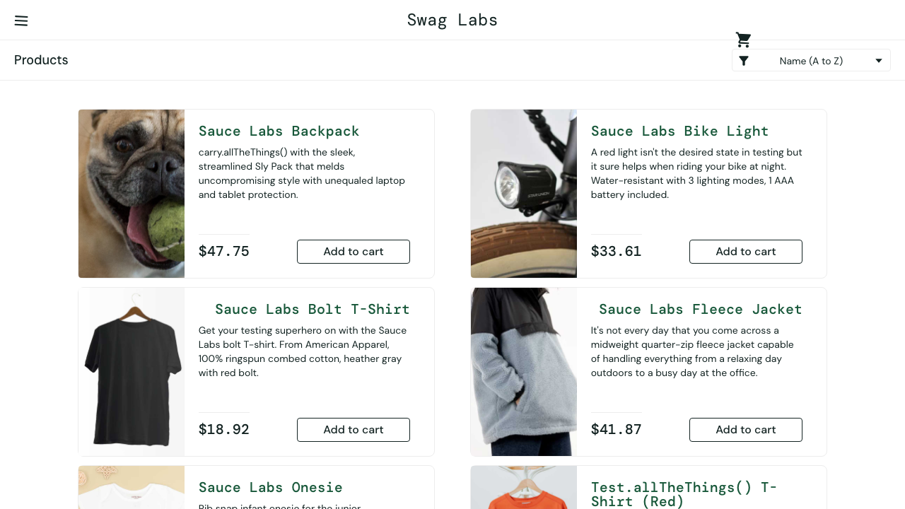

# BUG-009: Prices, images and layout differ from the real catalog

|                    |                                                                          |
| ------------------ | ------------------------------------------------------------------------ |
| **Severity**       | High                                                                     |
| **Type**           | Visual / Data                                                            |
| **Affected users** | visual_user                                                              |
| **Environment**    | https://www.saucedemo.com · Chromium, Firefox, WebKit · found 2026-11-02 |
| **Status**         | Open — tracked by an expected-failure test                               |

## Steps to reproduce

1. Log in as `visual_user`.
2. Compare the inventory with `standard_user`'s.

## Expected

Same prices, images and layout as for every other user.

## Actual

Prices are random on every load (e.g. Backpack $30.60 instead of $29.99), the first image is broken, and the cart icon and buttons are shifted.

## Automated test

features/known-bugs/visual-user.feature → _Prices match the catalog_; features/quality/visual.feature → _visual_user sees the same inventory as standard_user_

## Evidence

